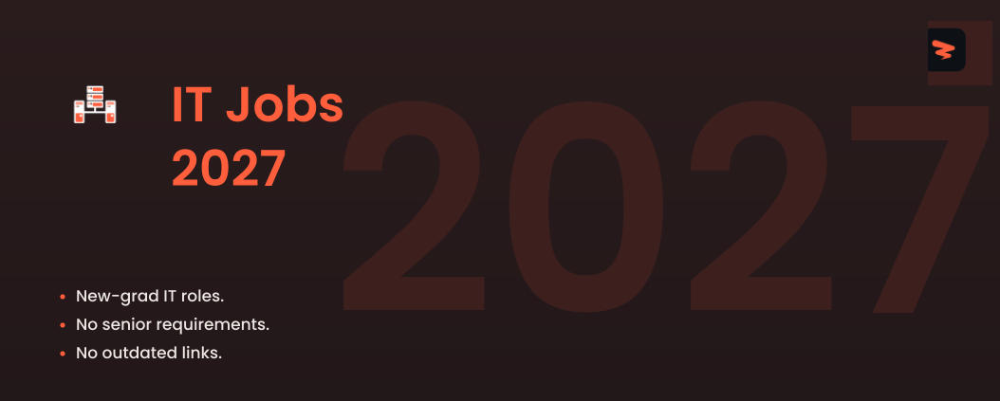

<!-- Cover -->

# IT Jobs 2027

🚀 IT, systems administration, and networking jobs for new graduates, updated every 10 minutes.

  
  
  
  

---

## **Website & Autofill Extension**

Explore Zapply's website and check out:

- Our Chrome extension, which autofills job applications in seconds.
- A dedicated job board featuring the latest openings across various roles.
- User accounts with multiple profiles for different resume types and roles.
- Job application tracking with streaks and commitment awards.

Experience an advanced career journey with us! 🚀

  

## Explore Around

Connect and seek advice from a growing network of fellow students and new grads.

  
  &nbsp;&nbsp;
  

---

 

<h3>🖥️ <strong>Systems Administration</strong></h3>

| Company | Role | Location | Posted | **Apply** |
|---------|------|----------|--------|----------|
| **GDIT** | NCIS Cyber Systems Administrator - SecOps   Active TS/SCI clearance | USA VA Quantico | 7h |  |
| **RTX** | Teamcenter System Administrator (Hybrid - Puerto Rico) | PR-SANTA ISABEL-B4 | 12h |  |
| **Booz Allen Hamilton** | Systems Administrator | Offutt AFB, NE | 1d |  |
| **Boeing** | Mid-Level Classified Linux System Administrator **Sign on Bonus Potential** | Berkeley, MO | 1d |  |
| **CACI** | Infrastructure/Systems Administrator | Sarasota, FL, US | 1d |  |
| **RTX** | Windows System Administrator | CA-EL SEGUNDO-R01 | 1d |  |
| **RTX** | System Administrator Manager | TX-MCKINNEY | 1d |  |
| **GDIT** | Network/System Administrator (Net/Sys Admin) III | MA Bedford | 1d |  |
| **GDIT** | Systems Administrator I | USA NC Fort Bragg | 1d |  |
| **Mach Industries** | Systems Administrator | Huntington Beach, California,... | 1d |  |
| **Leidos** | DevOps Platform Engineer/Linux Systems Administrator | Bethesda, MD | 2d |  |
| **Argonne National Laboratory** | Linux/HPC System Administrator | Lemont, IL USA | 2d |  |
| **Leidos** | Classified Area System Administrator | Huntsville, AL | 2d |  |
| **Draper** | Linux (RHEL) Classified Systems Administrator 2 | Cambridge, MA | 2d |  |
| **Draper** | Classified Systems Administrator 2 | Cambridge, MA | 2d |  |
| **Sierra** | IT Infrastructure Engineer | San Francisco, CA | 2d |  |
| **Saalex Solutions** | Journeyman Server and Computer Systems Administrator | Ridgecrest, California | 2d |  |
| **BAE Systems** | Systems Administrator | Springfield, Virginia | 2d |  |
| **Booz Allen Hamilton** | System Administrator, Mid | Arlington, VA | 3d |  |
| **Boeing** | Mid-Level Classified Windows System Administrator **Sign on Bonus Potential** | USA - Patuxent River, MD | 3d |  |
| **CACI** | Systems Administrator | Warner Robins GA US | 3d |  |
| **Northrop Grumman** | Systems Administrator (Technician) (26-483) AHT | United... | 3d |  |
| **Booz Allen Hamilton** | Windows System Administrator, Mid | Indian Head, MD | 4d |  |
| **Axiom Space** | Infrastructure Systems Administrator | Houston | 4d |  |
| **Boeing** | Mid-Level Systems Administrator **Sign on Bonus Potential** | USA - Seattle, WA | 4d |  |
| **Northrop Grumman** | NG Only: Systems Administrator (26-486) AHT | United... | 4d |  |
| **Leidos** | Linux Systems Administrator and Network Engineer | Aiea, HI | 4d |  |
| **CACI** | Systems Administrator II (Satellite Operations) | Schriever AFB, CO, US | 4d |  |
| **Amentum** | Windows System Administrator (SA) 2 with Poly | MD-Fort Meade | 4d |  |
| **Amentum** | System Administrator | CO-Grand Junction | 4d |  |
| **Northrop Grumman** | System Administrator – SATCOM Technician (26-469) | 2 Locations | 4d |  |
| **SpaceX** | IT Systems Administrator, Launch | Hawthorne, CA | 4d |  |
| **Nokia** | Network Infrastructure Engineer | United States | 4d |  |
| **Relativity Space** | System Administrator II | Stennis Space | 4d |  |
| **SpaceX** | IT Systems Administrator, IT Applications | McGregor, TX | 4d |  |
| **Amentum** | Mid-Level System Administrator MDX - HSV | AL-Redstone Arsenal | 5d |  |
| **Thermo Fisher Scientific** | Workfront System Administrator | Pittsburgh, Pennsylvania, USA | 5d |  |
| **Firestorm** | Systems Administrator | San Diego, United States | 1w |  |
| **VetsEZ** | Windows System Administrator (Remote Opportunity) | Atlanta, Georgia | 1w |  |
| **Blue Origin** | Lunar Systems Administrator - Level 1 | Space Coast, FL | 1w |  |
| **General Atomics** | Learning Systems Administrator | San Diego, California | 1w |  |
| **BAE Systems** | Systems Administrator | Rome, New York | 1w |  |
| **BAE Systems** | Systems Administrator (COTS ERP) | Sterling, Virginia | 1w |  |
| **Vultr** | Linux Systems Administrator (3rd Shift) | Remote - United States | 1w |  |
| **North Wind Group** | Systems Administrator - IT Professional (NWS 00959) | LIVERMORE, California | 1w |  |
| **Parsons** | Systems Administrator | MD (Field Location), R188423 | Date unknown |  |
| **Carnegie Mellon SEI** | Mac Systems Administrator | Pittsburgh, PA | 1w |  |
| **Carnegie Mellon University** | Mac Systems Administrator | Pittsburgh, PA | 1w |  |
| **Parsons** | Systems Administrator | CO, Boulder, R188330 | Date unknown |  |
| **SpaceX** | IT Network Infrastructure Engineer, Launch | Starbase, TX | 2w |  |
| **Anduril** | Training Systems Administrator | Costa Mesa, California, United... | 3w |  |
| **Anduril** | Systems Administrator | Costa Mesa, California, United... | 3w |  |
| **OpenAI** | Network Infrastructure Engineer, Global Network Infra (WAN) | San Francisco | 3w |  |
| **Anduril** | Systems Administrator | Costa Mesa, California, United... | 4w |  |
| **Accenture Federal Services** | Tableau Server & AWS Systems Administrator | Washington, DC | 4w |  |
| **HPE (University)** | HPC AI Systems Administrator Intern | Bloomington, Minnesota, United... | 1mo |  |
| **Credence** | IT System Administrator, Journeyman | Hampton, Virginia | 1mo |  |
| **LangChain** | IT Systems Administrator | San Francisco, CA | 1mo |  |
| **Saalex Solutions** | Systems Administrator | Keyport, Washington | 1mo |  |
| **PingWind** | Junior Systems Administrator | Quantico VA | 2026-09-01 |  |
| **Nozomi Networks** | Go-To-Market Systems Administrator | United States | 2026-08-18 |  |
| **Accenture Federal Services** | Systems Administrator | Arlington, VA | 2026-08-07 |  |
| **Accenture Federal Services** | Infrastructure Systems Administrator | Springfield, VA | 2026-07-09 |  |
| **Synergy ECP** | Platform / Linux System Administrator | Annapolis Junction, MD | 2026-06-24 |  |
| **Freedom Technology Solutions Group** | System Administrator 676 | Annapolis Junction, MD | 2026-06-03 |  |
| **Saalex Solutions** | System Administrator I | Tidewater, Virginia | 2026-04-20 |  |
| **PingWind** | Systems Administrator | Shaw AFB, SC / Kuwait | 2026-03-11 |  |
| **Avalore** | System Administrator, Level 2 | Annapolis Junction, Maryland | 2025-10-27 |  |
| **Avalore** | System Administrator, Level 3 | Annapolis Junction, Maryland | 2025-10-27 |  |
| **Five Rings** | Experienced/Lateral - Linux Systems Administrator | New York | 2024-04-11 |  |

Apply for more jobs at

<h3>🎙️ <strong>Help Desk & Support</strong></h3>

| Company | Role | Location | Posted | **Apply** |
|---------|------|----------|--------|----------|
| **GDIT** | Help Desk/IT Support Analyst for National Library of Medicine | USA MD Bethesda | 7h |  |
| **GDIT** | Enterprise Service Desk Technician - Cabling and Switching | BEL Mons - Supreme | 14h |  |
| **GDIT** | Enterprise Service Desk Technician - Unified Communications | BEL Mons - Supreme | 14h |  |
| **SpaceX** | IT Support Technician (Help Desk) | Hawthorne, CA | 18h |  |
| **Per Scholas** | Instructional Assistant (IT Support) | Charlotte, North Carolina,... | 21h |  |
| **Booz Allen Hamilton** | IT Support Desk Technician | Honolulu, HI | 1d |  |
| **CME Group** | Desktop Support Intern - Year-Round | Chicago | 1d |  |
| **Amentum** | Service Desk Support – Mid (Team 01) | DC-Washington | 1d |  |
| **Baxter International** | Technical Support Specialist | Raleigh, North Carolina | 1d |  |
| **Baxter International** | Technical Support Specialist - Connected Devices | Batesville, Indiana | 1d |  |
| **Baxter International** | Technical Support Specialist | United States of America - Remote | 1d |  |
| **Thomson Reuters** | IT Support Engineer | VA | 1d |  |
| **Leidos** | Service Desk Tier 1 Technician | Norfolk, VA | 1d |  |
| **Thermo Fisher Scientific** | Executive IT Support Liaison | Waltham, Massachusetts, USA | 1d |  |
| **Sierra Nevada Corporation** | IT Service Desk Intern (Summer 2027) | Lone Tree, CO | 2d |  |
| **ASM Global** | IT Technician | Shreveport, LA | 2d |  |
| **Qualcomm** | IT Support Analyst, Associate | San Diego, CA | 2d |  |
| **Atlantic Health System** | IT Support Technician I Per Diem | Morristown, NJ, United States | 2d |  |
| **Cummins** | IT Support Associate - Level I 3rd Shift | Rocky Mount, NC, United States | 2d |  |
| **NTT Data** | Desktop Support-Windows OS - Onsite Bay Minette, AL | Bay Minette, US-AL | 2d |  |
| **NTT Data** | Service Desk /Helpdesk Associate - -Remote | Lincoln, US-NE | 2d |  |
| **BAE Systems** | Junior Desktop Support Technician | Hudson, New Hampshire | 2d |  |
| **Machina Labs** | IT Support Specialist | Chatsworth, CA | 2d |  |
| **Amentum** | NCC Help Desk - NISSC - CMSFS | CO-Colorado Springs | 2d |  |
| **Centene** | IT Technical Support Specialist IV | Austin | 3d |  |
| **Becton Dickinson** | Technical Support Specialist 3 | USA TX - San Antonio - Silicon Dr | 3d |  |
| **Becton Dickinson** | Technical Support Specialist 2 | USA TX - San Antonio - Silicon Dr | 3d |  |
| **Cigna** | Technical Support Associate Analyst - Cigna Healthcare | Missoula, MT | 3d |  |
| **LexisNexis Risk Solutions** | Technical Support Specialist II | Alpharetta, GA | 3d |  |
| **Fresenius Medical Care** | IT Support Operator | Baja California, Tijuana, MEX | 3d |  |
| **Blue Origin** | Launch Communications IT Support Analyst II | Greater Seattle Area | 3d |  |
| **NTT Data** | Desktop support-Windows operating system | Warren, US-OH | 3d |  |
| **CVS Health** | Associate Manager, Help Desk Support | TX - Work from home | 3d |  |
| **Leidos** | Service Desk Technician/VTC | Oakland, SC | 4d |  |
| **Eaton** | Edge OS Platform Engineer IT Specialist | Irvine, California, USA, 92618 | 4d |  |
| **CACI** | Service Desk Analyst | Ashburn, VA, US | 4d |  |
| **Thermo Fisher Scientific** | Technical Support Specialist II | Tewksbury, Massachusetts, USA | 4d |  |
| **Thermo Fisher Scientific** | Technical Support Specialist II | Remote, Texas, USA | 4d |  |
| **ASM Global** | IT Support Coordinator | North Charleston, SC | 4d |  |
| **NBCUniversal** | Universal Film Production IT Support Internships – Summer 2027 | Universal City, CA | 4d |  |
| **SpaceX** | IT Support Technician | Hawthorne, CA | 4d |  |
| **Leidos** | SMIT Service Desk Tier I Technician (NIPR) | Meridian, ID | 5d |  |
| **Oshkosh Corporation** | Motorsports Technical Support Specialist | New Hudson, Michigan, United States | 5d |  |
| **LabCorp** | IT System Integraton Specialist-IT Desktop Support Tech | Englewood CO | 5d |  |
| **Per Scholas** | Instructional Assistant (IT Support) | Bronx, New York, United States | 5d |  |
| **Astreya** | IT Support Specialist II | Scottsdale, AZ | 5d |  |
| **Postman** | IT Support Engineer – San Francisco | San Francisco, CA, US | 5d |  |
| **Unisys** | Tech Service Desk L2 | USA Remote | 5d |  |
| **Unisys** | Tech Service Desk L2 | USA Remote | 5d |  |
| **SharkNinja** | Spring 2027: Service Desk Co-op (January to June) | Needham, MA, United States | 5d |  |
| **Honeywell** | Technical Support Specialist | Salem, OR, United States | 5d |  |
| **Barry-Wehmiller** | IT Service Desk Analyst | Akron, OH | 1w |  |
| **Sierra Nevada Corporation** | IT Support Technician III | Sparks, NV | 1w |  |
| **Generac** | Systems Support Specialist II - Zeeland, Michigan | Zeeland, MI - USA | 1w |  |
| **Amentum** | IT Desktop Support Technician | TN-Tullahoma | 1w |  |
| **CACI** | Help Desk Analyst | Alexandria, VA, US | 1w |  |
| **Amazon.com Services LLC** | Control Systems Engineer – Rapid Response Team, OMHS Field Technical Support | Richardson, TX | 1w |  |
| **Amazon.com Services LLC** | Control Systems Engineer – Rapid Response Team, OMHS Field Technical Support | Dallas, TX | 1w |  |
| **Amazon.com Services LLC** | Control Systems Engineer – Rapid Response Team, OMHS Field Technical Support | Coppell, TX | 1w |  |
| **Illinois Tool Works** | Manufacturing Technical Support Specialist | Camdenton, Missouri | 1w |  |
| **Tenable** | IT Support Engineer (Hybrid - Columbia MD) | Headquarters - Maryland - Columbia | 1w |  |
| **Crest Industries** | IT Help Desk Technician | Lafayette, Louisiana | 1w |  |
| **Booz Allen Hamilton** | Helpdesk SharePoint Specialist | Arlington, VA | 1w |  |
| **Jabil** | IT Support Technician II (Shift Rotations) | Memphis, TN | 1w |  |
| **MongoDB** | Manager, IT Support | New York City | 1w |  |
| **Sysco** | Associate Analyst, Service Desk Support - GSC - US | Sysco Corporate | 1w |  |
| **Per Scholas** | Instructional Assistant (IT Support) | Indianapolis, Indiana, United... | 1w |  |
| **North Wind Group** | PC Support Technician – Mobility & IT Support (NWS 00953) | LIVERMORE, California | 1w |  |
| **Saronic Technologies** | IT Technician (Austin) | Austin, TX | 1w |  |
| **Versapay** | Technical Support Specialist | United States (Remote) | 1w |  |
| **Atlantic Health System** | IT Support Technician II | Morristown, NJ, United States | 1w |  |
| **Trimble** | IS Help Desk Intern | CO, Westminster | 2w |  |
| **Mach Industries** | Help Desk Technician, Entry Level | Huntington Beach, California,... | 2w |  |
| **True Anomaly** | Help Desk Analyst II | Long Beach, CA | 2w |  |
| **Smartsheet** | Technical Support Specialist II (Remote Eligible - Costa Rica) | San Jose, CR | 2w |  |
| **Axon** | IT Support Technician III | Scottsdale, Arizona, United States | 2w |  |
| **Sony Interactive Entertainment** | IT Support Specialist (Contract) | CA | 2w |  |
| **Base Power** | Industrial IT Support Specialist | Austin, TX | 2w |  |
| **Sierra Nevada Corporation** | IT Support Technician Intern | Vandalia, OH | 2w |  |
| **Stripe** | IT Support Engineer | San Francisco | 2w |  |
| **SpaceX** | IT Support Technician | McGregor, TX | 3w |  |
| **BAE Systems** | Service Desk Analyst | Sterling, Virginia | 3w |  |
| **Antares** | IT Helpdesk Technician | Los Angeles | 3w |  |
| **Fireworks AI** | IT Support Engineer | New York | 3w |  |
| **RunPod** | Technical Support Engineer (L1) | Remote - USA | 3w |  |
| **BorgWarner** | IT Technician Intern | Arden - North Carolina - USA | 1mo |  |
| **BorgWarner** | IT Service Desk Intern (Year-Round) | Auburn Hills - Michigan - USA | 1mo |  |
| **Crest Industries** | IT Help Desk Technician | Pineville, Louisiana | 1mo |  |
| **Reflect Orbital** | IT Support Specialist Intern | Hawthorne, CA | 1mo |  |
| **QuEra Computing** | IT Specialist | Boston, MA, USA | 1mo |  |
| **VAST** | IT Support Specialist II | Long Beach, California, United... | 1mo |  |
| **Vultr** | Technical Support Engineer | Remote - United States | 1mo |  |
| **Stripe** | IT Support Engineer | New York | 1mo |  |
| **Oura** | IT Support Specialist II | On-site - San Francisco, California | 1mo |  |
| **iCapital Network** | Service Desk Engineer - Associate | Salt Lake City, Utah, United States | 1mo |  |
| **Accenture Federal Services** | Service Desk Support Specialist | Washington, DC | 1mo |  |
| **Plaid** | Technical Support Engineer | San Francisco | 1mo |  |
| **Lumafield** | IT Specialist | San Francisco, CA | 1mo |  |
| **Illinois Tool Works** | Manufacturing Technical Support Specialist | Hopkinton, Massachusetts | 1mo |  |
| **Astranis** | IT Support Technician Associate (Winter 2027) | San Francisco | 1mo |  |

Apply for more jobs at

<h3>🌐 <strong>Networking</strong></h3>

| Company | Role | Location | Posted | **Apply** |
|---------|------|----------|--------|----------|
| **GDIT** | Junior Network Engineer (Palo Alto) | USA VA Richmond | 14h |  |
| **Booz Allen Hamilton** | Network Administrator | San Diego, CA | 1d |  |
| **Anthropic** | Corporate Network Engineer | Remote-Friendly (Travel... | 1d |  |
| **NTT Data** | Network Engineer - SECRET Clearance | Norfolk, US-VA | 1d |  |
| **Booz Allen Hamilton** | Network Engineer | Reston, VA | 2d |  |
| **Booz Allen Hamilton** | Network Engineer | Wright Patterson AFB, OH | 2d |  |
| **Zayo** | Network Engineer | United States | 2d |  |
| **Leidos** | Network Engineer | Orlando, FL | 2d |  |
| **GDIT** | Network Engineer SME | USA HI Camp Smith | 2d |  |
| **CACI** | Satellite Control Network Modifications Network Engineer | Colorado Springs, CO, US | 2d |  |
| **CACI** | Optical Network Engineer | Florham Park, NJ, US | 2d |  |
| **CACI** | Optical Network Engineer | Florham Park, NJ, US | 2d |  |
| **Boeing** | Entry Level Command and Data Handling Network Engineer (Autonomous Navigation Systems) | USA - El Segundo, CA | 2d |  |
| **Baker Hughes** | Americas Network Engineer | TX-THE WOODLANDS | 2d |  |
| **Delta Dental** | Network Engineer | Okemos, MI | 3d |  |
| **Zayo** | Network Engineer III - Packet | United States | 3d |  |
| **Leidos** | F5 Load Balance Network Engineer | Alexandria, VA | 3d |  |
| **Leidos** | OT/IT Network Engineer (Transportation) | McLean, VA | 3d |  |
| **GM Financial** | Global Network Engineer III | Arlington, TX, United States | 3d |  |
| **MITRE** | Communications Network Engineering Intern | McLean, Virginia | 3d |  |
| **BAE Systems** | Network Engineer (Expert) | Herndon, Virginia | 3d |  |
| **BAE Systems** | Network Engineer | Albuquerque, New Mexico | 3d |  |
| **Apple** | Network Engineer, Infrastructure Services | San Francisco Bay Area | 3d |  |
| **GDIT** | Enterprise Network Engineer - TS/SCI w/Poly | USA MD Annapolis Junction | 4d |  |
| **Apple** | Optical Network Engineer, Infrastructure Services | Dallas | 4d |  |
| **Apple** | Retail Network Engineer, Infrastructure Services | Austin Metro Area | 4d |  |
| **Alo Yoga** | Network Engineer | Beverly Hills LAND, Beverly... | 4d |  |
| **SpaceX** | Network Engineer (Enterprise Product Development) | Redmond, WA | 4d |  |
| **Comcast** | Engineer 2, Network Engineering | TX - Plano, 7900 Windrose... | 5d |  |
| **Comcast** | Engineer 2, Network Engineering | TX - Plano, 7900 Windrose... | 5d |  |
| **Astreya** | Network Operations Engineer II | Denver, CO | 5d |  |
| **Astreya** | Network Operations Engineer II | Denver, CO | 5d |  |
| **Astreya** | Network Operations Engineer II | Denver, CO | 5d |  |
| **University of Texas at Austin** | Enterprise Network Engineer III | AUSTIN, TX | 5d |  |
| **Aerospace Corporation** | IT Network Engineer | El Segundo, CA | 5d |  |
| **Capital One** | Network Engineer 4 ((Cloud Operations Resilience Engineering) | Plano, TX | 1w |  |
| **Blue Origin** | Network Engineer III | Huntsville, AL | 1w |  |
| **Comcast** | Engineer 2, Network Engineering | NJ - Bellmawr | 1w |  |
| **Berkshire Hathaway Energy** | OT Network Engineer 1/2/3/Sr | Omaha, NE, United States | 1w |  |
| **Berkshire Hathaway Energy** | Network Engineer 1/2 | Urbandale, IA, United States | 1w |  |
| **Intuitive** | Network Engineer | Sunnyvale, CA | 1w |  |
| **VetsEZ** | Network Engineer (Remote Opportunity) | San Antonio, Texas | 1w |  |
| **Saronic Technologies** | Network Administrator | Austin, TX | 1w |  |
| **Saronic Technologies** | Network Engineer | Austin, TX | 1w |  |
| **AeroVironment** | Infrastructure Network Engineer | Albuquerque, NM | 1w |  |
| **Axiom Space** | Flight Network Engineer (Station Critical Network) IV | Houston | 1w |  |
| **Axiom Space** | Ground Network Engineer (Development Network) IV | Houston | 1w |  |
| **Axiom Space** | Flight Network Engineer (Commercial Network) III | Houston | 1w |  |
| **Amentum** | Network Engineer | HI-Fort Shafter | 1w |  |
| **BAE Systems** | Network Engineer (SME) | Herndon, Virginia | 1w |  |
| **NBCUniversal** | Network Engineer | New York, NEW YORK | 1w |  |
| **Microsoft** | Cloud Network Engineer II | United States | 1w |  |
| **University of Texas at Austin** | Linux Network Engineering Scientist Associate | PICKLE RESEARCH | 1w |  |
| **Atoms** | Network Engineer | San Francisco, CA | 1w |  |
| **Capital One** | Network Engineer 4 (Manager, IC0 (CaCe) | McLean, VA | 1w |  |
| **Google** | Network Engineer | United States | Date unknown |  |
| **General Atomics** | Network Engineer Analyst | Poway, California | 1w |  |
| **Northrop Grumman** | Network Administrator 3/4 - TS/SCI | United States-Virginia-Dulles | 1w |  |
| **SpaceX** | OT Network Engineer | College Station, TX | 1w |  |
| **General Atomics** | Network Engineer Analyst | Poway, California | 1w |  |
| **SpaceX** | Network Engineer (Starlink Maritime) | Redmond, WA | 2w |  |
| **Astranis** | Satellite Network Operations Engineer | San Francisco | 2w |  |
| **Point72** | Network Engineer, Systematic Trading Infrastructure | New York, NY | 2w |  |
| **AMD** | AI Scale-up Switch Network Engineer | Secaucus, NJ, United States | 2w |  |
| **Sierra Nevada Corporation** | Network Engineer Intern (Summer 2027) | Hagerstown, MD | 3w |  |
| **Saronic Technologies** | Classified Network Engineer | Austin, TX | 3w |  |
| **CFS Energy** | Intern - I&C and Network Engineer - Spring or Summer 2027 | Devens, MA | 3w |  |
| **Aevex Aerospace** | Network Engineer | Baltimore, Maryland, United States | 3w |  |
| **RTX** | 2027 Network Engineering Intern | CO-COLORADO SPRINGS | 1mo |  |
| **True Anomaly** | Network Engineer | Long Beach, CA | 1mo |  |
| **AMAX** | Network Engineer | Fremont, California | 1mo |  |
| **Hitachi** | Intern – Network Engineering | Pittsburgh, Pennsylvania,... | 1mo |  |
| **MITRE** | Associate Network Engineer | Bedford, Massachusetts | 1mo |  |
| **Anduril** | Network Engineer, Factory Systems and Operational Technology | Costa Mesa, California, United... | 1mo |  |
| **BeyondTrust** | Cloud Network Engineer | Remote United States | 1mo |  |
| **Hermeus** | Network Engineer | Los Angeles, CA | 2026-09-18 |  |
| **Trace3** | Network Engineer III | Linthicum Heights, MD | 2026-09-17 |  |
| **OpenAI** | Network Operations Engineer, AI Networking | San Francisco | 2026-09-15 |  |
| **Jump Trading** | Network Engineer   Wireless | Chicago | 2026-09-14 |  |
| **xAI** | OT Network Engineer, Physical Infrastructure - Memphis | Southaven, MS | 2026-09-02 |  |
| **Base Power** | Network Administrator | Austin, TX | 2026-08-31 |  |
| **Avalore** | Network Engineer | Arlington, Virginia | 2026-08-31 |  |
| **SupplyHouse.com** | Network Engineer | Remote, Remote, United States | 2026-08-18 |  |
| **xAI** | Network Engineer, Battery Storage - Memphis | Memphis, TN | 2026-08-18 |  |
| **OpenAI** | Network Engineer | San Francisco | 2026-08-14 |  |
| **Point72** | Network Engineer | New York, NY | 2026-07-02 |  |
| **Gimlet Labs** | Network Engineer | San Francisco, CA | 2026-06-01 |  |
| **Synergy ECP** | Network Engineer | Annapolis Junction, MD | 2026-05-21 |  |
| **Cerebras Systems** | Manufacturing Linux Network Engineer | Sunnyvale, CA | 2026-05-01 |  |
| **Synergy ECP** | Network Engineer 24/7 Support | Annapolis Junction, MD | 2026-04-21 |  |
| **Saalex Solutions** | Network Administrator II | Tidewater, Virginia | 2026-04-20 |  |
| **Saalex Solutions** | Network Administrator III | Tidewater, Virginia | 2026-04-20 |  |
| **Saalex Solutions** | Network Engineer I | Tidewater, Virginia | 2026-04-20 |  |

Apply for more jobs at

<h3>☁️ <strong>Cloud & Infrastructure</strong></h3>

| Company | Role | Location | Posted | **Apply** |
|---------|------|----------|--------|----------|
| **GDIT** | Cloud Administrator - TS/SCI with Polygraph | VA Reston | 1d |  |
| **GDIT** | Cloud Administrator - TS/SCI with Polygraph | USA VA Reston - Customer... | 1d |  |
| **Booz Allen Hamilton** | Cloud Administrator | Lexington Park, MD | 1w |  |
| **Point72** | IT Operations Engineer, Data Center Technology | New York, NY | 3w |  |

Apply for more jobs at

<h3>📋 <strong>General IT</strong></h3>

| Company | Role | Location | Posted | **Apply** |
|---------|------|----------|--------|----------|
| **HP Inc** | IT Operations Service Delivery Representative | All Cities, Massachusetts,... | 19h |  |
| **Guidehouse** | Data Analyst & IT Consultant - Real Estate Portfolio | DC, Washington | 1d |  |
| **Salesforce** | Offensive Security Engineer - Red Team | California San Francisco | 1d |  |
| **Booz Allen Hamilton** | Cloud Migration Product Owner | Lexington, MA | 1d |  |
| **Boeing** | IT Systems Engineer - Millennium Space Systems | USA - El Segundo, CA | 1d |  |
| **Boeing** | Cloud Platform Administrator (Mid-Level, Senior or Lead) **Sign on Bonus Potential** | Berkeley, MO | 1d |  |
| **Boeing** | Cloud Infrastructure Administrator (Mid-Level, Senior or Lead) **Sign on Bonus Potential** | Berkeley, MO | 1d |  |
| **Leidos** | Cyber Intelligence Analyst - Weekday Nights | Odenton, MD | 1d |  |
| **Leidos** | Information Technology Support | Groton, CT | 1d |  |
| **Jabil** | Cyber Risk Specialist II | St. Petersburg/Tampa, FL | 1d |  |
| **LLNL** | Communications Specialist – Livermore Information Technology Program | Livermore, CA | 1d |  |
| **AlphaSights** | Application Support Engineer (Remote) - US | Remote, New York | 1d |  |
| **Booz Allen Hamilton** | Database Administrator | McLean, VA | 2d |  |
| **Booz Allen Hamilton** | Cloud Infrastructure Support Engineer | Fort Belvoir, VA | 2d |  |
| **Leidos** | Cyber Defense Analyst – 12 Hour Weekend Shifts | Suitland, MD | 2d |  |
| **Citi** | Technology, Cyber Security, Summer Analyst, Irving - USA, 2027 | Irving Texas United States | 2d |  |
| **CACI** | Cyber Monitoring Analyst | Hampton, VA, US | 2d |  |
| **GDIT** | Cybersecurity Analyst | USA OK Oklahoma City | 2d |  |
| **GDIT** | Information Technology/Assurance (IT/IA) Specialist III | USA NM Albuquerque | 2d |  |
| **General Atomics** | Cleared Cloud Cyber Analyst | Chantilly, Virginia | 2d |  |
| **BAE Systems** | IT Systems Admin 1 | Nashua, New Hampshire | 2d |  |
| **BAE Systems** | Systems Admin I - Closed Area Hot Seat | Nashua, New Hampshire | 2d |  |
| **Nelnet** | IT Manager | Lincoln Nelnet | 3d |  |
| **Northrop Grumman** | Cybersecurity Analyst | United States-Arizona-Chandler | 3d |  |
| **Unisys** | Associate Systems Admin | Remote, PA, United States of... | 3d |  |
| **Analog Devices** | Information Technology Intern | MA Wilmington | 3d |  |
| **Microsoft** | Cybersecurity Threat Hunter - New Zealand | United States | 3d |  |
| **Amentum** | Cybersecurity Analyst (Intermediate) | FL-Tampa | 3d |  |
| **GDIT** | Cloud Operations and Customer Support Engineer | VA Springfield | 3d |  |
| **NTT Data** | Cyber Incident Detection/Response Analyst (Mid) | Springfield, US-VA | 3d |  |
| **BAE Systems** | Cyber Threat Intelligence Analyst (All Source) - IMMEDIATE OPPORTUNITY | Quantico, Virginia | 3d |  |
| **Micron Technology** | Cyber Security Operations Center Analyst / AI-Automation Engineer | Boise, ID - Main Site | 3d |  |
| **Hims & Hers** | IT Operations Engineer | Menlo Park, California | 3d |  |
| **Salesforce** | Production Support Engineering SMTS | California San Francisco | 4d |  |
| **AeroVironment** | Cybersecurity Analyst III | Huntsville, AL | 4d |  |
| **Northrop Grumman** | 2026 Associate Cybersecurity Analyst - Pathways Program - Beavercreek OH | United States-Ohio-Beavercreek | 4d |  |
| **Nightwing** | Cyber Threat Analyst | Sterling, VA | 4d |  |
| **Nightwing** | Cybersecurity Risk Analyst | Sterling, VA | 4d |  |
| **Microsoft** | Cybersecurity Threat Hunter - Australia | United States | 4d |  |
| **Amentum** | Cybersecurity Analyst | Remote | 4d |  |
| **Microsoft** | Cybersecurity Threat Hunter | United States | 4d |  |
| **Thorlabs** | Summer 2027 Information Technology Internship | Jessup, Maryland | 4d |  |
| **Thorlabs** | Summer 2027 Information Technology Internship | Newton, New Jersey | 4d |  |
| **Micron** | Cyber Security Operations Center Analyst / AI-Automation Engineer | Boise, Idaho, United States of... | 4d |  |
| **GM Financial** | Associate Cybersecurity Analyst | Arlington, TX, United States | 4d |  |
| **Accenture Federal Services** | IT Operations Analyst | Arlington, VA | 4d |  |
| **Comcast** | Comcast Cybersecurity: Cyber Incident Response Triage Analyst | Virtual | 5d |  |
| **Zoetis** | Information Technology Intern – Veterinary Medicine R&D & Commercial Genetics | Kalamazoo - Kilgore Road | 5d |  |
| **Nightwing** | Cybersecurity Analyst | Sterling, VA | 5d |  |
| **Aerospace Corporation** | Enterprise Operations Engineer | Springfield, VA | 5d |  |
| **Cummins** | Cybersecurity Operations Analyst | Columbus, IN, United States | 5d |  |
| **Physical Intelligence** | IT Operations Engineer | San Francisco | 6d |  |
| **Snorkel AI** | Research Scientist, Open Benchmarks Red Team | NY | 1w |  |
| **State Street** | Cyber Security Operations Center Analyst, Full-time Internship (Jan - June 2027) | Quincy, Massachusetts | 1w |  |
| **CACI** | SQL Database Administrator / Database Performance Engineer – ServiceNow Platform | Chantilly, VA, US | 1w |  |
| **CACI** | Information Technology/Cyber Security Analyst | Fayetteville, NC, US | 1w |  |
| **General Motors** | IT Operations Analyst | 2 Locations | 1w |  |
| **Hims & Hers** | IT Operations Engineer | Remote | 1w |  |
| **Allstate** | Database Admin Expert | USA - IL | 1w |  |
| **Ameriprise Financial** | EUC Design Engineer | Minneapolis, Minnesota | 1w |  |
| **VetsEZ** | InterSystems IRIS Cache Database Administrator (Remote Opportunity) | Dallas, Texas | 1w |  |
| **General Motors** | IT Operations Engineer | 2 Locations | 1w |  |
| **Entegris** | Power Platform / Copilot Studio Intern – AI - Summer Intern | Aurora, IL | 1w |  |
| **Live Nation** | Cyber Security Support Engineer | Work From Home - Texas | 1w |  |
| **CVS Health** | Executive Support Engineer | CT - Hartford | 1w |  |
| **Millennium Management** | Trade Floor Support Engineer | New York, New York, United... | 1w |  |
| **Cboe** | EUC Engineer | Overland Park OPX | 1w |  |
| **Cummins** | Information Technology Co-op Positions | Columbus, IN, United States | 1w |  |
| **Northrop Grumman** | Cybersecurity Analyst - 19898 - Roy Utah | United States-Utah-Roy | 1w |  |
| **Amentum** | Cybersecurity Systems Analyst (Associate) | FL-Tampa | 1w |  |
| **Fiserv** | Cyber Threat Intelligence Analyst | Berkeley Heights, New Jersey | 1w |  |
| **CIBC** | Production Support Engineer II (SQL/Linux) | Chicago, IL | 1w |  |
| **LabCorp** | Business Systems Analyst - Laboratory Information Technology Systems | NC Durham 10 Moore Drive | 1w |  |
| **Applied Intuition** | IT Operations Engineer | Sunnyvale | 1w |  |
| **LLNL** | Mission Partner Sites IT Operations Associate | Livermore, CA | 1w |  |
| **Regal Rexnord** | Information Technology Summer Intern | Grafton, Wisconsin, United States | 1w |  |
| **State Street** | Trading Application Support Engineer, Senior Associate | Boston, Massachusetts | 1w |  |
| **Amgen** | Medical Value and Health Information Technology (MVHIT) Manager - Health IT Liaison - South Central | Texas San Antonio | 1w |  |
| **University of Texas at Austin** | Cybersecurity Analyst II | UT MAIN | 1w |  |
| **Federal Reserve System** | 2027 Information Technology Internship | St. Louis, MO | 2w |  |
| **Saronic Technologies** | Integration IT Manager | Austin, TX | 2w |  |
| **Fluor** | Associate IT Operations Specialist II | Piketon, US-OH, United States | 2w |  |
| **SpaceX** | Database Administrator | Hawthorne, CA | 2w |  |
| **Applied Intuition** | IT Operations Engineer | Ann Arbor | 2w |  |
| **Accenture Federal Services** | Cyber Threat Intelligence Analyst | Lorton, VA | 2w |  |
| **Zoox** | Information Technology & Applications Intern \[Summer 2027\] | Foster City, CA | 2w |  |
| **Trane Technologies** | 2027 Information Technology Intern | Davidson North Carolina | 3w |  |
| **SpaceX** | IT NOC Technician | Hawthorne, CA | 3w |  |
| **True Anomaly** | Threat Detection & Response Engineer III | Long Beach, CA | 3w |  |
| **Caterpillar** | 2027 Summer Corporate Intern - Information Technology | Irving Texas | 3w |  |
| **Wiz** | Solutions Support Engineer - US East | Remote - USA | 3w |  |
| **Apex Technology** | Red Team Engineer, Product Security | Los Angeles | 3w |  |
| **Braze** | Customer Success Platform Administrator | Austin | 3w |  |
| **Braze** | Customer Success Platform Administrator | Chicago | 3w |  |
| **Braze** | Customer Success Platform Administrator | San Francisco | 3w |  |
| **Impulse Space** | Information Technology Intern, Service Delivery (Summer 2027) | Redondo Beach, California | Date unknown |  |
| **HP Inc** | Enterprise Operations Engineering Internship | Spring, Texas, United States of... | 1mo |  |
| **Rockwell Automation** | Intern, Information Technology | Milwaukee, Wisconsin, United States | 1mo |  |
| **LPL Financial** | Intern 2027 - Cybersecurity Analyst | Fort MillCharlotte | 1mo |  |
| **Elanco** | Junior IT Engineer – Information Technology Intern (Summer 2027) | Indianapolis, IN | 1mo |  |

Apply for more jobs at

---

### Live Job Boards

  
  &nbsp;&nbsp;
  
  &nbsp;&nbsp;
  

  
  &nbsp;&nbsp;
  
  &nbsp;&nbsp;
  

  
  &nbsp;&nbsp;
  
  &nbsp;&nbsp;
  

  

### Curated Internships

  
  &nbsp;&nbsp;
  
  &nbsp;&nbsp;
  

  
  &nbsp;&nbsp;
  

### Career Resources

  
  &nbsp;&nbsp;
  

---

Add new jobs to our listings keeping in mind the following:

- Located in the US.
- Create a new issue to submit different job positions.
- Update a job by submitting an issue with the job URL and required changes.

Our team reviews within 24-48 hours and approved jobs are added to the main list!

Questions? Create a miscellaneous issue, and we'll assist! 🙏

**🎯 629 current opportunities from 201 companies**

**Found this helpful? Give it a ⭐ to support Zapply!**

*Not affiliated with any companies listed. All applications redirect to official career pages.*

---

## Data & Reuse

Job listings are public information provided by employers, who remain responsible for their accuracy. The compilation and the added data fields (skills, degree and visa estimates, tags) are by Zapply.

You may use, share, and build on this data, including for commercial purposes, as long as you:

- Link back to this repository as the source (followed link, no nofollow).
- Credit Zapply as the data source.
- Do not resubmit the listings to third-party job aggregators or feeds.
- Do not present Zapply enrichment fields as official employer statements; they are automated estimates provided as-is, without warranty.

You may use the name Zapply to attribute the data. Please do not use the Zapply logo or imply endorsement without written permission.

Questions or a different use? Open an issue. We say yes more often than not.

---

**Last Updated**: November 21, 2026

