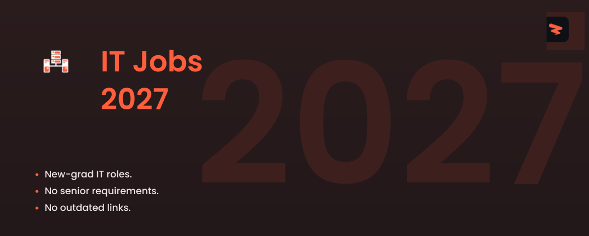

<!-- Cover -->

# IT Jobs 2027

🚀 IT, systems administration, and networking jobs for new graduates, updated every 10 minutes.

  
  
  
  

---

## **Website & Autofill Extension**

Explore Zapply's website and check out:

- Our Chrome extension, which autofills job applications in seconds.
- A dedicated job board featuring the latest openings across various roles.
- User accounts with multiple profiles for different resume types and roles.
- Job application tracking with streaks and commitment awards.

Experience an advanced career journey with us! 🚀

  

## Explore Around

Connect and seek advice from a growing network of fellow students and new grads.

  
  &nbsp;&nbsp;
  

---

 

<h3>🖥️ <strong>Systems Administration</strong></h3>

| Company | Role | Location | Posted | **Apply** |
|---------|------|----------|--------|----------|
| **GDIT** | F-35 Systems Administrator   Active Secret clearance | VA Arlington | 2h |  |
| **GDIT** | JMSC-IP Constructive Systems Administrator (LVC-G Sr) – SECRET clearance required | USA HI Schofield | 2h |  |
| **Anduril** | Training Systems Administrator | Costa Mesa, California, United... | 19h |  |
| **Parsons** | Linux Systems Administrator - Junior | VA, Centreville, R188078 | Date unknown |  |
| **SpaceX** | IT Windows Systems Administrator | Starbase, TX | 23h |  |
| **SpaceX** | IT Windows Systems Administrator | Bastrop, TX | 23h |  |
| **Anduril** | Systems Administrator | Costa Mesa, California, United... | 1d |  |
| **VetsEZ** | Windows System Administrator (Remote Opportunity) | Atlanta, Georgia | 1d |  |
| **Amentum** | Enterprise Systems Administrator MDX - SSFB/HSV | CO Colorado Springs | 1d |  |
| **Nokia** | Infrastructure Systems Administrator | United States | 1d |  |
| **GDIT** | NATO Functional Area Services Systems Administrator | International | 2d |  |
| **State Street** | Network Infrastructure Engineer, AVP | Quincy Massachusetts | 2d |  |
| **OpenAI** | Network Infrastructure Engineer, Global Network Infra (WAN) | San Francisco | 2d |  |
| **Captivation** | Systems Administrator 3 - Linux/STE/STN/Virtualization/Ansible/Python/Kubernetes/Docker | Annapolis Junction, MD | 2d |  |
| **Captivation** | Systems Administrator 2 - Linux | Annapolis Junction, MD | 2d |  |
| **Magna** | IT System Administrator Supervisor | Nashville, Illinois, US | 2d |  |
| **Draper** | Classified Systems Administrator 2 | Cambridge, MA | 3d |  |
| **Draper** | Linux (RHEL) Classified Systems Administrator | Cambridge, MA | 3d |  |
| **RTX** | System Administrator | TX-MCKINNEY | 3d |  |
| **Amentum** | Junior Microsoft System Administrator | VA-Fort Belvoir | 3d |  |
| **Booz Allen Hamilton** | Systems Administrator - Summer Intern | Annapolis Junction, MD | 3d |  |
| **Booz Allen Hamilton** | ServiceNow Systems Administrator, Mid | MacDill AFB, FL | 3d |  |
| **Booz Allen Hamilton** | Systems Administrator | Honolulu, HI | 3d |  |
| **AvePoint** | Customer Success Systems Administrator | Richmond, Virginia, United States | 3d |  |
| **AvePoint** | Customer Success Systems Administrator | Arlington, VA, United States | 3d |  |
| **AvePoint** | Gainsight & Customer Success Systems Administrator | Jersey City, NJ, United States | 4d |  |
| **CACI** | Infrastructure/System Administrator | Sterling, VA, US | 4d |  |
| **USAA** | Mid Level Infrastructure Engineer - Database Administrator | San Antonio | 5d |  |
| **Leidos** | System Administrator | Huntsville, AL | 5d |  |
| **Parsons** | Project Information Systems Administrator - Remote, US | Remote (Any Location), R187137 | Date unknown |  |
| **Parsons** | System Administrator - TS/SCI w/Poly | MD (Field Location), R183314 | Date unknown |  |
| **D. E. Shaw** | Systems Administrator (New York) | New York | Date unknown |  |
| **CACI** | Linux Infrastructure / Systems Administrator | Bethesda, MD, US | 1w |  |
| **Anduril** | Systems Administrator | Costa Mesa, California, United... | 1w |  |
| **RTX** | Principle System Administrator (Onsite) (PWE) | IA-CEDAR RAPIDS | 1w |  |
| **RTX** | Systems Administrator (PWE ) (ISSA) (Onsite) | IA-CEDAR RAPIDS | 1w |  |
| **Accenture Federal Services** | Tableau Server & AWS Systems Administrator | Washington, DC | 1w |  |
| **Unisys** | Night Shift L2 NOC Linux/Unix Systems Administrator | Remote, PA, United States of... | 1w |  |
| **Mach Industries** | IT Systems Administrator | Victorville, California, United... | 1w |  |
| **Thornton Tomasetti** | Cloud Systems Administrator | New York, NY | 1w |  |
| **Uline** | Systems Administrator Internship - Summer 2027 | Pleasant Prairie, WI | 1w |  |
| **CACI** | Windows Infrastructure / Systems Administrator | Bethesda, MD, US | 1w |  |
| **Oracle** | System Administrator 2-IT - Storage Engineer | Lee's Summit, MO, United States | 1w |  |
| **Boston Properties** | Systems Administrator | Boston, MA, United States | 1w |  |
| **T-Rex Solutions** | Linux Systems Administrator 2 | Fort Meade, Maryland | 1w |  |
| **Amentum** | Linux System Administrator IRES - SSFB | CO-Colorado Springs | 1w |  |
| **ALTEN Technology** | System Administrator | Troy, MI | 1w |  |
| **ALTEN Technology** | System Administrator | Westminster, CO | 1w |  |
| **Northrop Grumman** | Linux Systems Administrator - Top Secret | United States-California-Azusa | 1w |  |
| **Northrop Grumman** | Linux Systems Administrator 2/3 - Top Secret | United States-Florida-Melbourne | 1w |  |
| **FIS** | Systems Administrator II (3-6 Years experience l Onsite, Monday through Friday, New York, NY) | NY NYC 1120 Client | 1w |  |
| **SpaceX** | IT Network Infrastructure Engineer, Outside Plant | Starbase, TX | 3w |  |
| **HPE (University)** | HPC AI Systems Administrator Intern | Bloomington, Minnesota, United... | 1mo |  |
| **Accenture Federal Services** | Cloud Systems Administrator | Huntsville, AL | 1mo |  |
| **Accenture Federal Services** | Junior Cloud Systems Administrator | Colorado Springs, CO | 1mo |  |
| **Neuralink** | IT Systems Administrator Intern | Austin, Texas, United States | 2026-05-15 |  |

Apply for more jobs at

<h3>🎙️ <strong>Help Desk & Support</strong></h3>

| Company | Role | Location | Posted | **Apply** |
|---------|------|----------|--------|----------|
| **GDIT** | Help Desk Technician | USA FL MacDill AFB | 2h |  |
| **Jabil** | IT Support Technician I (2nd Shift) | Prince George, VA | 12h |  |
| **SpaceX** | IT Support Technician | McGregor, TX | 1d |  |
| **Aveva** | IT Support Engineer-1 | Philadelphia, Pennsylvania,... | 1d |  |
| **GDIT** | Information Technology Support Specialist - TS/SCI w/Poly | USA MD Annapolis Junction | 1d |  |
| **GDIT** | Information Technology Support Specialist - TS/SCI w/Poly | USA MD Annapolis Junction | 1d |  |
| **Teledyne** | Technical Support Specialist | Hudson, NH | 1d |  |
| **Leidos** | Desktop Support Technician | Point Mugu Nawc, CA | 1d |  |
| **CACI** | Service Desk Technician | Ashburn, VA, US | 1d |  |
| **Leidos** | IT Specialist Junior | Jacksonville, NC | 1d |  |
| **University of Miami** | Desktop Support Technician- Central (H) | Miami, Florida | 1d |  |
| **Stantec** | Desktop Support Analyst | Washington, DC, United States | 1d |  |
| **University of Miami** | Desktop Support Technician - Central (A) | Coral Gables, Florida | 1d |  |
| **Per Scholas** | Instructional Assistant (IT Support) | Buffalo, New York, United States | 1d |  |
| **Allen Control Systems** | IT Help Desk Engineer - Linux Level II ~ III | Austin, TX | 1d |  |
| **Raymond James Financial** | Desktop Support Associate Analyst | Denver, Colorado - United States, R | 2d |  |
| **NTT Data** | Desktop Support Technician | Syracuse, US-NY | 2d |  |
| **Per Scholas** | Instructional Assistant (IT Support) | United States | 2d |  |
| **Nidec** | IT Support Specialist | North America/USA/Ohio/Brooklyn... | 2d |  |
| **Wash U** | Technical Support Specialist I (Hybrid) - WashU IT | Washington University Medical | 2d |  |
| **Amentum** | Helpdesk Technician | WV Morgantown | 2d |  |
| **Leidos** | Desktop Support Technician | Suitland, MD | 2d |  |
| **CACI** | Systems Administration/Help Desk Analyst | Fort Meade, MD, US | 2d |  |
| **CACI** | Enterprise Service Desk Associate Technician (SIPRNet) | Tinker AFB, OK, US | 2d |  |
| **Per Scholas** | Instructional Assistant (IT Support) | Bronx, New York, United States | 2d |  |
| **Atlantic Health System** | IT Support Technician II | Morristown, NJ, United States | 2d |  |
| **NTT Data** | IT Help Desk Analyst | Washington, US-DC | 2d |  |
| **Trimble** | Technical Support Specialist -eCommerce & Digital Experience | CO Westminster | 3d |  |
| **Becton Dickinson** | Technical Support Specialist | WI Pleasant Prairie | 3d |  |
| **Jabil** | IT Support Technician II | Byhalia, MS | 3d |  |
| **NTT Data** | Desktop Support-Windows OS - Onsite Bay Minette, AL | Bay Minette, US-AL | 3d |  |
| **Antares** | IT Helpdesk Technician | Los Angeles | 4d |  |
| **Sierra Nevada Corporation** | IT Service Desk Intern (Summer 2027) | Lone Tree, CO | 4d |  |
| **Sierra Nevada Corporation** | IT Service Desk Intern (Summer 2027) | Lone Tree, CO | 4d |  |
| **Neighborly** | Help Desk Tech | Waco, TX | 4d |  |
| **Thermo Fisher Scientific** | Technical Support Specialist II | Hillsboro, Oregon, USA | 4d |  |
| **University of Maryland** | IT Coordinator, Service Desk Level 2 | University of Maryland College Park | 4d |  |
| **Unisys** | Team Lead/Supervisor Service Desk | Blue Bell, PA, United States of... | 4d |  |
| **Fireworks AI** | IT Support Engineer | New York | 4d |  |
| **CAE** | IT Service Desk Technician | Ft Hood, Texas | 5d |  |
| **SpaceX** | Executive IT Support Specialist | McGregor, TX | 5d |  |
| **ASM Global** | IT Specialist | Detroit, MI | 5d |  |
| **Danaher** | Customer Technical Support Specialist - ONSITE | Indianapolis, Indiana | 5d |  |
| **Parsons** | IT Specialist | NJ, Newark, R186061 | Date unknown |  |
| **Aalyria** | IT Support Specialist | Hybrid (Livermore, California, US) | Date unknown |  |
| **ConceptPlus** | Help Desk Specialist | Remote (Washington, US) | Date unknown |  |
| **Nidec** | IT Specialist | North America/USA/Arkansas/Mena, AR | 1w |  |
| **Wash U** | Technical Support Specialist III (Part-Time) – Linux Support | Washington University Medical | 1w |  |
| **1Password** | IT Intern, IT Support - Winter 2027 | Remote (United States  Canada) | 1w |  |
| **Boeing** | Classified Help Desk Manager **Sign on Bonus Potential** | USA - Hazelwood, MO | 1w |  |
| **Motorola Solutions** | Information Technology (IT) Support Specialist | Irvine, CA | 1w |  |
| **Aptiv** | IT Support Analyst II - Desktop Systems | USA Walnut Creek, CA - WR | 1w |  |
| **ElevenLabs** | IT Support Engineer | New York | 1w |  |
| **Amentum** | NCC Help Desk - NISSC - CMSFS | CO-Colorado Springs | 1w |  |
| **Dark Wolf Solutions** | Tier 1 Help Desk Technician | Ogden, UT | 1w |  |
| **Nelnet** | IT Support Team Lead | Lincoln, NE | 1w |  |
| **Booz Allen Hamilton** | Tier 2 Service Desk Technician | Arlington, VA | 1w |  |
| **Oracle** | IT Support | Abilene, TX, United States | 1w |  |
| **Thermo Fisher Scientific** | Technical Support Specialist II, Water Analysis Instruments | Wisconsin | 1w |  |
| **SeatGeek** | Helpdesk Automation Engineer | New York, New York | 1w |  |
| **Crest Industries** | IT Help Desk Technician | Pineville, Louisiana | 1w |  |
| **Lucid Motors** | Partner Technical Support Specialist | Fremont, CA | 1w |  |
| **Oshkosh Corporation** | Trackside IT Support Engineer | Huntersville, North Carolina,... | 1w |  |
| **Reflect Orbital** | IT Support Specialist Intern | Hawthorne, CA | 1w |  |
| **QuEra Computing** | IT Specialist | Boston, MA, USA | 1w |  |
| **Amentum** | IT Support Technician | MO-St. Louis | 1w |  |
| **Trimble** | IS Help Desk Technician | OR, Lake Oswego | 1w |  |
| **T-Rex Solutions** | Help Desk Specialist | Fort Meade, Maryland | 1w |  |
| **ASM Global** | IT Support Technician | Oklahoma City, OK | 1w |  |
| **Becton Dickinson** | Technical Support Specialist 2 | Texas | 1w |  |
| **Unisys** | Desktop Support Computer Technician ONSITE in Rensselaer, NY | Rensselaer, NY, United States... | 1w |  |
| **Honeywell** | Technical Support Specialist | Framingham, MA, United States | 1w |  |
| **VAST** | IT Support Specialist II | Long Beach, California, United... | 2w |  |
| **Stripe** | IT Support Engineer | New York | 2w |  |
| **BorgWarner** | IT Service Desk Intern (Year-Round) | Auburn Hills - Michigan - USA | 2w |  |
| **iCapital Network** | Service Desk Engineer - Associate | Salt Lake City, Utah, United States | 3w |  |
| **Sierra Nevada Corporation** | IT Support Technician Intern (Summer 2026) | Sparks, NV | 1mo |  |
| **BorgWarner** | IT Technician Intern | Arden - North Carolina - USA | 1mo |  |
| **Rocket Lab** | IT Support Specialist | Albuquerque, NM | 1mo |  |
| **Rocket Lab** | IT Support Specialist | Long Beach, CA | 1mo |  |
| **Astranis** | IT Support Technician Associate (Winter 2027) | San Francisco | 1mo |  |
| **Axon** | IT Support Technician III | Boston, Massachusetts, United... | 1mo |  |
| **Muon Space** | Junior Help Desk Intern (Summer 2027) | Mountain View, CA | 1mo |  |
| **GM Financial** | Intern - IT Support Technician | Arlington, TX, United States | 1mo |  |
| **Antares** | IT Helpdesk Intern - Summer 2027 | Los Angeles | 1mo |  |
| **SpaceX** | IT Support Technician, VIP Support | Washington, DC | 1mo |  |
| **Sony Interactive Entertainment** | IT Support Specialist | CA | 2026-08-29 |  |
| **General Matter** | Helpdesk Technician | Paducah, KY | 2026-08-16 |  |
| **Sony Interactive Entertainment** | IT Support Coordinator (Contract Role) | CA | 2026-07-21 |  |
| **Divergent Technologies** | IT Help Desk Technician II | Torrance, California, United States | 2026-04-16 |  |

Apply for more jobs at

<h3>🌐 <strong>Networking</strong></h3>

| Company | Role | Location | Posted | **Apply** |
|---------|------|----------|--------|----------|
| **CACI** | Network Administrator II (Shift 3-B) | Springfield, VA, US | 11h |  |
| **CACI** | IT Network Engineer | Albuquerque, NM, US | 11h |  |
| **SpaceX** | OT Network Engineer, Mission Systems | Memphis, TN | 18h |  |
| **VetsEZ** | Network Engineer (Remote Opportunity) | San Antonio, Texas | 1d |  |
| **Comcast** | Network Engineer | NJ - Mount Laurel, 1800 Bishops... | 1d |  |
| **Comcast** | Network Engineer | NJ - Mount Laurel, 1800 Bishops... | 1d |  |
| **Booz Allen Hamilton** | Network Administrator | San Diego, CA | 1d |  |
| **SpaceX** | IT Network Engineer | Memphis, TN | 1d |  |
| **SpaceX** | IT Network Administrator | Memphis, TN | 1d |  |
| **GDIT** | Network Engineer - TS/SCI with Polygraph | USA VA McLean | 2d |  |
| **University of Texas at Austin** | Enterprise Network Engineer I | AUSTIN, TX | 2d |  |
| **Motorola Solutions** | Onsite WAVE Network Engineer - Washington, D.C. | Washington DC Remote Work, More... | 2d |  |
| **Leidos** | Communications Network Engineer Mid | Oceanside, CA | 2d |  |
| **CACI** | Network Engineer 3 | Fort Meade, MD, US | 2d |  |
| **NBCUniversal** | Network Engineer | Stamford, Connecticut | 2d |  |
| **Booz Allen Hamilton** | Network Engineer | McLean, VA | 2d |  |
| **Sierra Nevada Corporation** | Network Engineer Intern (Summer 2027) | Hagerstown, MD | 3d |  |
| **GDIT** | Systems/Network Engineer (TS/SCI /w poly required) | USA MD Annapolis Junction | 3d |  |
| **GDIT** | Network Administrator Associate - Eielson AFB | USA AK Eielson AFB | 3d |  |
| **Southwest Airlines** | Network Engineer - Infrastructure Network Security | Dallas, TX | 3d |  |
| **Astreya** | Network Engineer IV | Fremont, CA | 3d |  |
| **Booz Allen Hamilton** | Network Engineer | Fayetteville, NC | 3d |  |
| **Saronic Technologies** | Classified Network Engineer | Austin, TX | 3d |  |
| **CFS Energy** | Intern - I&C and Network Engineer - Spring or Summer 2027 | Devens, MA | 3d |  |
| **Astreya** | Network Operations Engineer II | Denver, CO | 4d |  |
| **Aevex Aerospace** | Network Engineer | Baltimore, Maryland, United States | 4d |  |
| **Baker Hughes** | Americas Network Engineer | TX-THE WOODLANDS | 4d |  |
| **Northrop Grumman** | Network Engineer - Level 3 or 4 | United... | 4d |  |
| **Impulse Space** | Network Engineer (Corporate IT) | Redondo Beach, California | Date unknown |  |
| **Impulse Space** | Network Engineer (Test Engineering) | Redondo Beach, California | Date unknown |  |
| **Leidos** | Field/Base Communications Network Engineer | Bethesda, MD | 5d |  |
| **The Travelers Companies** | Mainframe Network Engineer | CT Hartford | 5d |  |
| **Leidos** | Network Engineer - WAN - 2nd Shift | Hampton, VA | 5d |  |
| **Schweitzer Engineering Laboratories** | Network Engineer | Washington - Pullman | Date unknown |  |
| **Schweitzer Engineering Laboratories** | Network Engineer - Manufacturing | Washington - Pullman | Date unknown |  |
| **Google** | Network Engineer | United States | Date unknown |  |
| **ByteDance** | Network Engineer Graduate (Physical Network Infra) - 2027 Start | San Jose, California | Date unknown |  |
| **ByteDance** | Network Engineer Graduate (Physical Network Infra) - 2027 Start | Seattle, Washington | Date unknown |  |
| **Zayo** | Network Engineer | United States | 1w |  |
| **Amentum** | Network Administrator II | SC-Shaw AFB | 1w |  |
| **KION Group** | Network Engineer | Grand Rapids, MI, United States | 1w |  |
| **Morgan Stanley** | L3 Network Operations Engineer | Alpharetta, Georgia, United... | 1w |  |
| **Uline** | Network Engineer Team Lead | Pleasant Prairie, WI | 1w |  |
| **True Anomaly** | Network Engineer | Long Beach, CA | 1w |  |
| **Thales** | Network Engineer | Irvine | 1w |  |
| **Verizon** | Network Engineer II | Houston, Texas | 1w |  |
| **AMAX** | Network Engineer | Fremont, California | 1w |  |
| **Anduril** | Network Engineer, Factory Systems and Operational Technology | Costa Mesa, California, United... | 1w |  |
| **Astreya** | Network Operations Engineer II | Denver, CO | 1w |  |
| **AIG** | Wireless Network Engineer | 300 Kimball Drive Parsippany, NJ | 1w |  |
| **Trace3** | Network Engineer SME | Linthicum Heights, MD | 2w |  |
| **Voloridge Investment Management** | Network Engineer | Jupiter, FL | 2w |  |
| **Trace3** | Network Engineer III | Linthicum Heights, MD | 1mo |  |
| **xAI** | Network Engineer | Palo Alto, CA | 1mo |  |
| **xAI** | OT Network Engineer, Physical Infrastructure - Memphis | Southaven, MS | 1mo |  |
| **Rocket Lab** | IT Network Engineer II - Launch | Wallops Island, VA | 1mo |  |
| **SupplyHouse.com** | Network Engineer | Remote, Remote, United States | 2026-08-18 |  |
| **xAI** | Network Engineer, Battery Storage - Memphis | Memphis, TN | 2026-08-18 |  |
| **Point72** | Network Engineer | New York, NY | 2026-07-02 |  |
| **Jane Street** | Network Engineer, Security | New York, New York, United States | 2025-08-15 |  |
| **Gotion** | Network Engineer | Manteno, Illinois | 2024-11-05 |  |

Apply for more jobs at

<h3>☁️ <strong>Cloud & Infrastructure</strong></h3>

| Company | Role | Location | Posted | **Apply** |
|---------|------|----------|--------|----------|
| **CACI** | Cloud Administrator -- AWS and Azure Cloud | Chantilly, VA, US | 1d |  |
| **Point72** | IT Operations Engineer, Data Center Technology | New York, NY | 5d |  |
| **Accenture Federal Services** | Cloud Administrator | Washington, DC | 2026-09-01 |  |

Apply for more jobs at

<h3>📋 <strong>General IT</strong></h3>

| Company | Role | Location | Posted | **Apply** |
|---------|------|----------|--------|----------|
| **Accenture Federal Services** | Oracle Database Administrator | Washington, DC | 19h |  |
| **Fivetran** | IT Operations Analyst II | Denver, Colorado, United... | 21h |  |
| **Rockwell Automation** | EDGE, Information Technology Rotational Program | Milwaukee, Wisconsin, United States | 1d |  |
| **Trane Technologies** | 2027 Information Technology Intern | Davidson North Carolina | 1d |  |
| **Amgen** | Medical Value and Health Information Technology (MVHIT) Manager - Health IT Liaison - South Central | Texas Houston | 1d |  |
| **Intel** | Database Administrator PL/SQL Developer | Arizona Phoenix | 1d |  |
| **Amentum** | Cyber Security Analyst | CO-Englewood | 1d |  |
| **Booz Allen Hamilton** | Cyber Threat Hunter | McLean, VA | 1d |  |
| **Booz Allen Hamilton** | Cyber Threat Hunter | McLean, VA | 1d |  |
| **CACI** | Oracle Database Administrator (DBA) | Remote | 1d |  |
| **RTX** | Systems Operations Engineer - Onsite | VA-SPRINGFIELD | 1d |  |
| **Ecolab** | Associate IT Operations Analyst | Naperville, Illinois | 1d |  |
| **True Anomaly** | Threat Detection & Response Engineer III | Long Beach, CA | 2d |  |
| **GDIT** | Information Technology/Assurance (IT/IA) Specialist I (24/7) | USA CO Colorado Springs | 2d |  |
| **Boeing** | Database Administrator (Mid-Level or Senior) | USA - Berkeley, MO | 2d |  |
| **Verizon** | Network Threat Hunter | Irving, Texas | 2d |  |
| **Sysco** | Cyber Threat Hunting Analyst | Sysco Corporate | 2d |  |
| **CACI** | Cyber Data Analyst Engineer | St Louis MO US | 2d |  |
| **Fortinet** | Software Engineer – FortiSIEM Threat Detection & Integration | Sunnyvale, CA, United States | 2d |  |
| **Northrop Grumman** | Computer Support 3 - 20137 - Roy Utah | United States-Utah-Roy | 2d |  |
| **Northrop Grumman** | Classified Cybersecurity Analyst 3/4 - TS/SCI | United... | 2d |  |
| **Northrop Grumman** | Prinicpal Classified Cybersecurity Analyst - TS/SCI | United... | 2d |  |
| **ConceptPlus** | Oracle Database Administrator | Fort Meade, MD | Date unknown |  |
| **Microsoft** | Cybersecurity Threat Hunter - Weekend shift | United States | 3d |  |
| **GDIT** | Information Technology/Assurance (IT/IA) Specialist II | USA DC Washington | 3d |  |
| **GDIT** | NMMES FEM Cyber Analyst   Active Secret Clearance | USA AL Montgomery | 3d |  |
| **Caterpillar** | 2027 Summer Corporate Intern - Information Technology | Irving Texas | 3d |  |
| **Leidos** | Cyber Threat Analyst | Pearl Harbor, HI | 3d |  |
| **Leidos** | Cybersecurity Analyst Intern | Pearl Harbor, HI | 3d |  |
| **Accenture Federal Services** | IT Operations Analyst | Arlington, VA | 3d |  |
| **Apex Technology** | Red Team Engineer, Product Security | Los Angeles | 3d |  |
| **Sierra Nevada Corporation** | Cybersecurity Analyst Intern | Sparks, NV | 4d |  |
| **LabCorp** | IT Operations Coordinator II | Burlington, NC | 4d |  |
| **Amentum** | Jr. Cyber Defense Analyst MDX - SSFB/HSV | CO Colorado Springs | 4d |  |
| **Amentum** | Mid Cyber Defense Analyst MDX - SSFB/HSV | CO Colorado Springs | 4d |  |
| **Motorola Solutions** | Cyber Presales Specialist | Connecticut, US Offsite | 4d |  |
| **Leidos** | Cybersecurity Analyst | Odenton, MD | 4d |  |
| **Braze** | Customer Success Platform Administrator | Austin | 5d |  |
| **Braze** | Customer Success Platform Administrator | Chicago | 5d |  |
| **Braze** | Customer Success Platform Administrator | San Francisco | 5d |  |
| **Parsons** | Cyber Threat Analyst | MD, Annapolis Junction, R187849 | Date unknown |  |
| **Parsons** | Cyber Threat Analyst | MD, Annapolis Junction, R185741 | Date unknown |  |
| **Parsons** | Cyber Threat Operations & Intelligence Analyst | MD, Annapolis Junction, R181820 | Date unknown |  |
| **Motorola Solutions** | PremierOne Remote System Admin | California Southern Remote Work | 5d |  |
| **Micron Technology** | UPW / Water Systems Operations Engineer | Clay, NY | 5d |  |
| **GM Financial** | Cybersecurity Analyst - Tiger Team | Irving, TX, United States | 5d |  |
| **Accenture Federal Services** | SharePoint & Power Platform Support Ops | Washington, DC | 5d |  |
| **Johnson Controls** | IT Operations Engineer | York-Pennsylvania-United States... | 6d |  |
| **Blackstone** | 2024 Blackstone Technology and Innovations - Cybersecurity Operations Analyst | Miami | Date unknown |  |
| **Impulse Space** | Information Technology Intern, Service Delivery (Summer 2027) | Redondo Beach, California | Date unknown |  |
| **Impulse Space** | Infrastructure Administrator | Redondo Beach, California | Date unknown |  |
| **ConceptPlus** | Oracle Database Administrator | Remote (United States) | Date unknown |  |
| **Boeing** | Information Technology Engineer | USA - Tukwila, WA | 1w |  |
| **NTT Data** | Microsoft Dynamics365 and Power Platform Support Analyst | Birmingham | 1w |  |
| **Apple** | AI Security Engineer - Red Team | Seattle | 1w |  |
| **Thermo Fisher Scientific** | Application Administrator | Middleton, Wisconsin, USA | 1w |  |
| **CACI** | Cyber Security Analyst | Rome, NY, US | 1w |  |
| **Axiom Space** | Project Manager, Information Technology | Houston | 1w |  |
| **Citi** | Technology- Cyber Security, Full Time Analyst, Irving 2027 | Irving Texas United States | 1w |  |
| **Citi** | Technology, Cyber Security, Summer Analyst, Irving - USA, 2027 | Irving Texas United States | 1w |  |
| **Booz Allen Hamilton** | Cyber Security Analyst | Indianapolis, IN | 1w |  |
| **Jabil** | Cybersecurity Incident Response Team Security Analyst II | St. Petersburg/Tampa, FL | 1w |  |
| **Boeing** | Associate Enterprise Resource Planning Information Technology Engineer | USA - Hazelwood, MO | 1w |  |
| **Johnson Controls** | IT Operations Engineer | Gilbert-Arizona-United States... | 1w |  |
| **Carnegie Mellon University** | Associate AI Red Team Engineer | Pittsburgh, PA | 1w |  |
| **Rocket Companies** | Summer 2027 Internships - Marketing, Public Relations/Communications, Accounting, or Information... | Detroit, MI | 1w |  |
| **Uline** | Database Administrator Internship - Summer 2027 | Pleasant Prairie, WI | 1w |  |
| **Carnegie Mellon SEI** | Associate AI Red Team Engineer | Pittsburgh, PA | 1w |  |
| **CME Group** | Cyber Defense Analyst II | Chicago | 1w |  |
| **RE/SPEC Inc.** | SQL Server Database Administrator (Fed Gov) | Albuquerque, NM | 1w |  |
| **Aerospace Corporation** | Enterprise Operations Engineer | Springfield, VA | 1w |  |
| **Guidehouse** | Data Analyst & IT Consultant - Real Estate Portfolio | DC, Washington | 1w |  |
| **T-Rex Solutions** | Database Administrator 2 | Fort Meade, Maryland | 1w |  |
| **Astreya** | IT Systems Operations Engineer | San Francisco, CA | 1w |  |
| **Cisco** | UI Desktop Engineer Hybird, North Carolina Hybrid | RTP, North Carolina, US | 1w |  |
| **Fluor** | IT Operations Specialist II | Houston, US-TX, United States | 2w |  |
| **Rockwell Automation** | Intern, Information Technology | Milwaukee, Wisconsin, United States | 2w |  |
| **HPE (University)** | HPC/AI System Admin HW/SW Service Engineer Intern | All, Tennessee, United States... | 2w |  |
| **LPL Financial** | Intern 2027 - FAR Program - Internal Audit - Information Technology | Fort Mill/Charlotte | 3w |  |
| **INFICON** | Information Technology Intern | East Syracuse, NY | 3w |  |
| **General Matter** | Summer 2027 Internship - Information Technology | Los Angeles, CA | 3w |  |
| **HP Inc** | Enterprise Operations Engineering Internship | Spring, Texas, United States of... | 1mo |  |
| **TD Synnex** | Summer 2027 Internship Program   Technical, Applied Innovation Track: • Information Technology •... | Greenville, SC | 1mo |  |
| **Tencent** | IT Operations Intern | Washington-Bellevue | 1mo |  |
| **Tencent** | IT Operations Intern | California-Palo Alto | 1mo |  |
| **Caterpillar** | 2027 Summer Intern - Information Technology | Nashville, Tennessee | 1mo |  |
| **LPL Financial** | Intern 2027 - Cybersecurity Analyst | Fort MillCharlotte | 1mo |  |
| **Elanco** | Junior IT Engineer – Information Technology Intern (Summer 2027) | Indianapolis, IN | 1mo |  |
| **Campbell Soup Company** | Information Technology Internship Program - Summer 2027 | USA - NJ - Camden | 1mo |  |
| **Analog Devices** | Information Technology Intern | MA Wilmington | 1mo |  |
| **SpaceX** | Security Engineer (Red Team) | Starbase, TX | 1mo |  |
| **Audax Group** | IT Operations Co-Op NYC | New York, New York | 1mo |  |
| **Cummins** | Information Technology Summer Internship Positions | Columbus, IN, United States | 1mo |  |
| **AutoZone** | AutoZone 2027 Summer Internship – Information Technology | Memphis, TN, United States | 1mo |  |
| **Qualcomm** | Information Technology (IT) Internship – Summer 2027 | San Diego, CA | 1mo |  |
| **Charles River Associates** | Associate/Cyber Incident Response eDiscovery (Forensic Services practice) | Boston, MA, United States | 1mo |  |
| **Charles River Associates** | Consulting Associate/Cyber Incident Response eDiscovery (Forensic Services practice) | Boston, MA, United States | 1mo |  |
| **Texas Instruments** | Information Technology Intern – Security | Dallas, TX, United States | 1mo |  |
| **Texas Instruments** | Information Technology Intern – Data Engineering | Dallas, TX, United States | 1mo |  |
| **Point72** | IT Operations Engineer, End User Computing | San Francisco | 1mo |  |

Apply for more jobs at

---

### Live Job Boards

  
  &nbsp;&nbsp;
  
  &nbsp;&nbsp;
  

  
  &nbsp;&nbsp;
  
  &nbsp;&nbsp;
  

  
  &nbsp;&nbsp;
  
  &nbsp;&nbsp;
  

  

### Curated Internships

  
  &nbsp;&nbsp;
  
  &nbsp;&nbsp;
  

  
  &nbsp;&nbsp;
  

### Career Resources

  
  &nbsp;&nbsp;
  

---

Add new jobs to our listings keeping in mind the following:

- Located in the US.
- Create a new issue to submit different job positions.
- Update a job by submitting an issue with the job URL and required changes.

Our team reviews within 24-48 hours and approved jobs are added to the main list!

Questions? Create a miscellaneous issue, and we'll assist! 🙏

**🎯 539 current opportunities from 159 companies**

**Found this helpful? Give it a ⭐ to support Zapply!**

*Not affiliated with any companies listed. All applications redirect to official career pages.*

---

## Data & Reuse

Job listings are public information provided by employers, who remain responsible for their accuracy. The compilation and the added data fields (skills, degree and visa estimates, tags) are by Zapply.

You may use, share, and build on this data, including for commercial purposes, as long as you:

- Link back to this repository as the source (followed link, no nofollow).
- Credit Zapply as the data source.
- Do not resubmit the listings to third-party job aggregators or feeds.
- Do not present Zapply enrichment fields as official employer statements; they are automated estimates provided as-is, without warranty.

You may use the name Zapply to attribute the data. Please do not use the Zapply logo or imply endorsement without written permission.

Questions or a different use? Open an issue. We say yes more often than not.

---

**Last Updated**: October 31, 2026

